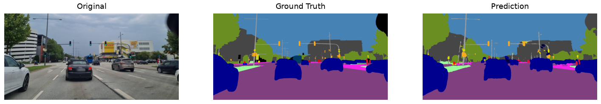

# Intersection-Focused Semantic Segmentation of Traffic Scenes

This project builds a pipeline to extract and analyze urban traffic infrastructure at intersections using semantic segmentation. It combines Cityscapes imagery and labels with GPS metadata and OpenStreetMap intersection geometry, trains segmentation models (UNet, DeepLabV3+, SegFormer) on the Cityscapes dataset and an intersection-only training subset, and evaluates them on CVAT-annotated intersection images with mIoU, pixel metrics, and instance metrics.

## Overview
**Key result:** The full Cityscapes training setup generalizes better than the intersection-only subset, and DeepLabV3+ is the strongest overall model in this project.

<figure>
  
  <figcaption><i>DeepLabV3+ prediction of an unseen Regensburg evaluation sample. The model was trained on the complete Cityscapes dataset</i></figcaption>
</figure>

### Key Takeaways
- DeepLabV3+ trained on the complete Cityscapes dataset achieved the strongest validation score in this project.
- Restricting training to intersection-only samples did not improve the models and often led to earlier overfitting.
- The final augmentation strategy keeps the helpful transforms and drops the ones that hurt robustness.

### Evaluation Summary
| Training data | Model | Train mIoU | Val mIoU | Regensburg mIoU | Train acc | Val acc | Regensburg acc |
| --- | --- | ---: | ---: | ---: | ---: | ---: | ---: |
| Intersections only | DeepLabV3+ | 0.694 | 0.509 | 0.318 | 0.960 |	0.929 |	0.841 |
| Intersections only | SegFormer | 0.558 | 0.467 | 0.333 | 0.933 |	0.912 |	0.855 |
| Intersections only | UNet | 0.347 | 0.328 | 0.247 | 0.882	| 0.874	| 0.821 |
| **Complete Cityscapes** | **DeepLabV3+** | **0.810** | **0.634** | **0.388** | **0.971**	| **0.952** |	**0.909** |
| Complete Cityscapes | SegFormer | 0.688 | 0.599 | 0.389 | 0.955 |	0.943 |	0.903 |
| Complete Cityscapes | UNet | 0.686 | 0.549 | 0.363 | 0.962	| 0.942	| 0.874 |

## Pipeline Overview
- Explore Cityscapes dataset structure and classes.
- Match images to GPS metadata (vehicle JSON files).
- Extract intersection candidates per city with OSMnx and export CSVs.
- Spatially filter GPS-tagged images inside intersection buffers.
- Filter images by vehicle heading toward the intersection (optional).
- Copy a reduced Cityscapes subset for training and evaluation.
- Train segmentation models and visualize predictions.
- Evaluate on CVAT-annotated images (mIoU, accuracy, instance counts).

## Project Structure
- `01_businessunderstanding/`: business understanding report and planning artifacts.
- `02_dataunderstanding/`: Cityscapes exploration notebook.
- `03_datapreparation/`: GPS matching, intersection extraction, filtering, subset copy.
- `04_modeling/`: model implementations, augmentation utilities, focal loss, HPC scripts.
- `05_evaluation/`: CVAT annotations, evaluation notebooks, metrics utilities.
- `output/`: generated CSVs and GeoJSONs from the data prep pipeline.
- `checkpoints/`, `trainingoutput/`: local model artifacts.
- Root notebooks: training, inference visualization, augmentation visualization.

## Setup
### Dependencies
Install the base requirements:

```bash
pip install -r requirements.txt
```


### Cityscapes Data

Download the Cityscapes dataset [here](https://www.cityscapes-dataset.com/downloads/): and move it into the  `data/` folder. 
- gtFine_trainvaltest.zip (241MB)
  - fine annotations for train and val sets (3475 annotated images) and dummy annotations (ignore regions) for the test set (1525 images)
- gtCoarse.zip (1.3GB)
  - coarse annotations for train and val set (3475 annotated images) and train_extra (19998 annotated images)
- leftImg8bit_trainvaltest.zip (11GB)
  - left 8-bit images - train, val, and test sets (5000 images)
- leftImg8bit_trainextra.zip (44GB)
  - left 8-bit images - trainextra set (19998 images, note that the image "troisdorf_000000_000073_leftImg8bit.png" is corrupt/black)
  


The structure is:
```
data/
  Cityscapes/
    gtFine_trainvaltest/gtFine/...
    gtCoarse/gtCoarse/...
    leftImg8bit_trainvaltest/leftImg8bit/...
    leftImg8bit_trainextra/leftImg8bit/...
    vehicle_trainvaltest/vehicle/...
    vehicle_trainextra/vehicle/...
```

### Generate TrainId Labels
Cityscapes label files must be converted to `*_labelTrainIds.png` for training.

```bash
# Linux/macOS
export CITYSCAPES_DATASET="./data/Cityscapes"
python -m cityscapesscripts.preparation.createTrainIdLabelImgs
```

```powershell
# Windows PowerShell
$env:CITYSCAPES_DATASET = "./data/Cityscapes"
python -m cityscapesscripts.preparation.createTrainIdLabelImgs
```

## Data Preparation Workflow (Notebooks)
1. **GPS matching**: `03_datapreparation/image_gps_matching.ipynb`
   - Matches Cityscapes images/annotations with GPS metadata and exports CSVs.
2. **Intersection extraction**: `03_datapreparation/intersection/intersection_pipeline.ipynb`
   - Uses OSMnx to find intersection nodes per city and exports CSVs.
3. **Spatial filtering**: `03_datapreparation/intersection/intersection_image_matching.ipynb`
   - Builds intersection buffers (GeoJSON) and filters GPS images inside them.
4. **Heading filtering**: `03_datapreparation/intersection/intersection_heading_matching.ipynb`
   - Filters images by camera heading toward intersection centers.
5. **Subset copy**: `03_datapreparation/intersection/filter_intersection_images.ipynb`
   - Copies the filtered subset into a standalone Cityscapes-like layout.
6. **HPC filtering (optional)**: `03_datapreparation/filter_cityscapes_for_hpc.ipynb`
   - Copies only `_leftImg8bit.png` and `_labelTrainIds.png` to reduce size for server upload.
7. **Augmentations**: `03_datapreparation/augmenation/augmentation_visualisation.ipynb`
   - Visualizes the custom augmentation pipeline defined in `augmentations.py`.
## Modeling
- Model implementations live in `04_modeling/models/`:
  - `UNet`, `DeepLabV3Plus`, `SegFormer`.
- Loss: `04_modeling/utils/focal_loss.py`.
- deprecated Training notebook for testing purposes: `model_training.ipynb`.
- main HPC training script, used for training on the HPC server: `04_modeling/hpcdata/train_script.py` and `submit_job.sh` .

## Evaluation
- CVAT annotations live in `05_evaluation/CVATAnnotations/` (RGB masks + `labelmap.txt`).
- Evaluation utilities:
  - `05_evaluation/utils/evaluation_utils.py` (model loading, inference, mIoU/accuracy).
  - `05_evaluation/utils/metrics_utils.py` (pixel metrics and instance counting: CC, watershed, peaks).
- Notebooks:
  - `05_evaluation/demo.ipynb` for a single-image demo.
  - `05_evaluation/evaluation.ipynb` for batch evaluation across the top models of (UNet, DeepLabV3+, SegFormer).
  - `05_evaluation/kennzahlen.ipynb` for detailed metric analysis.

## Visualization Notebooks
- `augmentation_visualisation.ipynb`: sanity checks for augmentation pipeline.
- `inference_visualisation.ipynb`: compare checkpoints and class sets (18 vs 20 classes).

## Outputs
The `output/` folder contains intermediate artifacts produced by the pipeline:
- `cityscapes_*_gps_data.csv`: GPS matches for fine/coarse data.
- `cityscapes_intersections_*_strassen.csv`: intersection candidates.
- `intersection_filtered/`: spatial filter results + GeoJSON buffers.
- `intersection_heading_filtered/`: heading-filtered subsets.

## Notes
- The training and evaluation notebooks assume 20 classes (including vegetation and parking). See `labels.py` for label mappings.
- The CVAT evaluation set is small and meant for qualitative checks and metric prototypes.